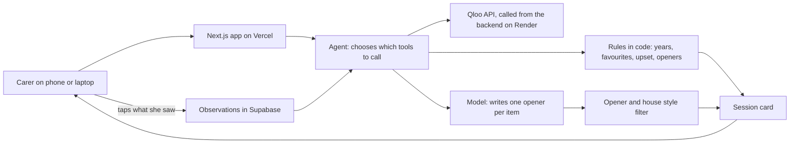
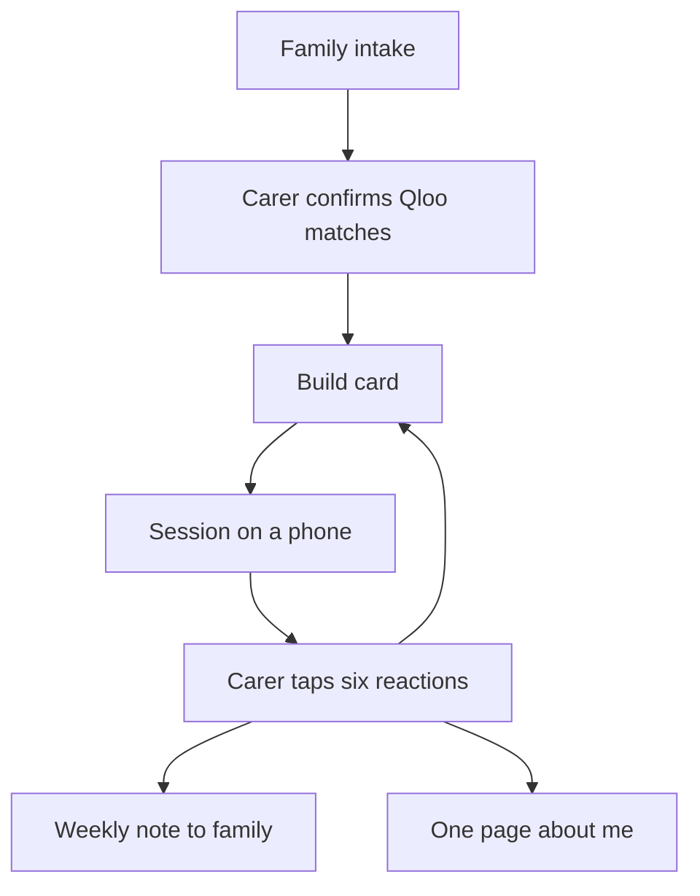

<!-- shots-hero:start -->

<!-- shots-hero:end -->

# Aftersong

<!-- badges:start -->
[](https://github.com/0xkinno/aftersong/actions) [](LICENSE)
<!-- badges:end -->

**Helps an activities coordinator in a memory care home, in the twenty minutes before a session, turn three remembered favourites into a card of music, film, food and places from the years a person remembers best.**

*The songs he still knows.*

<!-- links:start -->
| | |
|---|---|
| Live app | not deployed yet |
| For judges | /judge |
| Sample resident | /sample |
| Method | /method |
| Evidence | [EVIDENCE.md](EVIDENCE.md) |
| Repository | [https://github.com/0xkinno/aftersong](https://github.com/0xkinno/aftersong) |
| Video | not recorded yet |
<!-- links:end -->

## Tuesday, 2:30 pm

Marisol runs activities at a 40-bed memory care home in San Antonio. A new resident, Mr. Walter Okafor, 84, arrived on Monday. He has moderate dementia, says little, and is agitated in the afternoons. He grew up in Port Harcourt, Nigeria. His daughter in London filled in the intake form: Sam Cooke, *Casablanca*, and his mother's jollof rice.

The afternoon session starts in twenty minutes. Today Marisol would search for "music for 80 year olds" and play the same Sinatra playlist she plays for every resident. With Aftersong she opens a card instead: six to eight things from the years Walter was ten to thirty, each tied to something he loved, each with one plain question to ask. She runs the session, taps what she sees, and the next card starts from what worked.

<!-- shots-grid:start -->

<!-- shots-grid:end -->

## The problem

| What is true | Source |
|---|---|
<!-- problem:start -->
| **57 million** people were living with dementia worldwide in 2021, with nearly 10 million new cases every year. | [World Health Organization, Dementia fact sheet](https://www.who.int/news-room/fact-sheets/detail/dementia) |
| **42%** annual turnover among certified nursing assistants in US nursing homes in 2025 (42.34 percent, down from 44.16 percent in 2024), across 917 homes. | [AHCA, 2025-2026 Nursing Home Salary and Benefits Report summary, 9 September 2025](https://www.ahcancal.org/News-and-Communications/Blog/Pages/2025–2026-Nursing-Home-Report-Reveals-Lower-Turnover.aspx) |
| **22 trials** of reminiscence therapy for dementia, with 1,972 people, were reviewed by Cochrane in 2018. | [Woods, O'Philbin, Farrell, Spector and Orrell, Cochrane Database of Systematic Reviews, 2018, CD001120](https://www.cochrane.org/evidence/CD001120_reminiscence-therapy-dementia) |
| **Music memory** A 2015 study in Brain compared brain regions that hold long-term musical memory with Alzheimer's data and found they lose fewer neurons and show less metabolic decline than the rest of the brain. | [Jacobsen, Stelzer, Fritz, Chetelat, La Joie and Turner, Brain 138(8), 2438 to 2450, 2015](https://scholars.duke.edu/publication/1818925) |
| **Ages 10 to 30** People tend to recall more personal memories from roughly ages 10 to 30, the reminiscence bump. A systematic review of 68 studies puts the span at about 10 to 30 years for important events and about 5 to 30 for word-cued memories. | [Munawar, Kuhn and Haque, Understanding the reminiscence bump: a systematic review, PLoS ONE, 2018](https://doi.org/10.1371/journal.pone.0208595) |
| **This is me** is a free leaflet that staff, family or carers fill in to record a person's background, important events, preferences and routines, so care can be tailored to the person. | [Alzheimer's Society, This is me](https://www.alzheimers.org.uk/get-support/publications-factsheets/this-is-me) |
<!-- problem:end -->

Everyone assumes "music for old people" is one playlist. The songs that reach a person are the ones from their own years, filtered through their own taste. A generic list misses both.

## What it does

1. The family names up to five favourites from anywhere, through a private link. The carer confirms each match on screen.
2. Aftersong works out the years the person remembers best (ages 10 to 30, adjustable) and asks Qloo for music, film, television, food and places inside those years.
3. Every item is tied to a favourite. Each is tagged Personal (ranks far higher for him than for people of his generation), Shared era, or Widely known.
4. The carer runs the session on a phone, one item at a time, and taps one of six reactions. Only her taps become memory.
5. The next card starts from what lit up, and leaves out what upset. The family sees a weekly note and can delete anything logged. A one page "about me" sheet goes to the next carer.

The carer is the agent's eyes and ears. Only she can see a smile or a turned head, so only her taps count. What always gets through: a failed lookup, an empty window, and a model line that was blocked.

## What it will not do

| It will not | Enforced in |
|---|---|
| Put anything on a card because a model thinks he would like it | `backend/src/core/rules.ts`, `backend/src/core/card.ts` |
| Show an item outside his years, or without a year | `backend/src/core/rules.ts` |
| Show an item that Qloo did not link to a confirmed favourite or a confirmed reaction | `backend/src/core/rules.ts` |
| Repeat something that upset him | `backend/src/core/memory.ts` |
| Let a model line name anything not on the card, or claim a health effect | `backend/src/core/openers.ts`, `backend/src/core/house-style.ts` |
| Send names or health details to Qloo | `backend/src/qloo/guard.ts` |
| Pad a thin result with guesses | `backend/src/core/card.ts` |
| Let the family write the carer's reactions, or the carer overwrite the family's intake | `backend/src/service.ts` |

## Try it in two minutes

1. Open the sample, no sign-in: the live app, `/sample`.
2. Watch the agent place the card. Open "What the rules turned away".
3. Run the session on a phone. Compare with a plain AI list. Plan a room of four.
4. Break it: the hard case on `/judge` and the fault switch result.
5. Offline proof from a clean clone, no keys:

```bash
git clone https://github.com/0xkinno/aftersong
cd aftersong
npm --prefix backend ci
npm test
npm run verify:fixtures
npm run check
```

To check a live card, download its export from the sample page and run `npm run verify -- card.json`.

## How it works





```text
 SESSION CARD  Walter  1950 to 1970
 +--------------------------------------------+
 | MUSIC 1962                        PERSONAL |
 | An artist from the favourites' neighbours  |
 | Qloo links this to Sam Cooke               |
 | "Do you remember hearing this around 1962?"|
 +--------------------------------------------+
```

The agent decides the order of tool calls and writes the openers. Rules in code decide what goes on the card. The intelligence in the taste data is Qloo's; the judgement about what a person liked is the carer's.

## How Qloo is used

Every call, with file and line, is in [SDK_SURFACE.md](SDK_SURFACE.md). The platform probe, with what worked and what Qloo ignored, is in [PLATFORM_PROBE.md](PLATFORM_PROBE.md).

<!-- surface:start -->
| Feature | Call site | Status | Note |
|---|---|---|---|
| Resolve favourites with /search | [backend/src/qloo/client.ts:215](backend/src/qloo/client.ts#L215) | built, not yet called on a live key | Carer confirms the match on screen |
| Resolve a place to a locality with /search | [backend/src/qloo/resolve.ts:37](backend/src/qloo/resolve.ts#L37) | built, not yet called on a live key | Sent onward as an ID, never as the typed name |
| Cuisine and genre tags with /v2/tags | [backend/src/qloo/client.ts:220](backend/src/qloo/client.ts#L220) | built, not yet called on a live key | feature.semantic_search on |
| Batch lookup with /entities | [backend/src/qloo/client.ts:225](backend/src/qloo/client.ts#L225) | built, not yet called on a live key | One call for many IDs |
| Insights for the person's own signals | [backend/src/qloo/find.ts:59](backend/src/qloo/find.ts#L59) | built, not yet called on a live key | signal.interests.entities, artist, movie, tv_show, place, destination |
| Year window | [backend/src/qloo/find.ts:46](backend/src/qloo/find.ts#L46) | built, not yet called on a live key | Film and television only; enforced again in code for every domain |
| Cohort signal | [backend/src/qloo/find.ts:55](backend/src/qloo/find.ts#L55) | built, not yet called on a live key | 55_and_older, the oldest bracket |
| Same-pool re-scoring | [backend/src/qloo/find.ts:89](backend/src/qloo/find.ts#L89) | built, not yet called on a live key | Both scores from one pool |
| Explainability | [backend/src/qloo/find.ts:53](backend/src/qloo/find.ts#L53) | built, not yet called on a live key | Driver extraction is best effort (topDriver) |
| Popularity as a label | [backend/src/core/classify.ts:3](backend/src/core/classify.ts#L3) | built in code | Qloo's popularity field marks Widely known |
| Hometown thread | [backend/src/qloo/find.ts:50](backend/src/qloo/find.ts#L50) | built, not yet called on a live key | Locality ID as the location signal |
| Exclude what upset | [backend/src/qloo/find.ts:49](backend/src/qloo/find.ts#L49) | built in code | Also enforced in code |
| Cuisine tags as a filter | [backend/src/qloo/find.ts:51](backend/src/qloo/find.ts#L51) | built, not yet called on a live key | Food near the care home |
| Room planner re-scoring | [backend/src/agent/group.ts:2](backend/src/agent/group.ts#L2) | built in code | One pool, one re-score per resident |
| Plain AI counterfactual lookups | [backend/src/agent/plain.ts:62](backend/src/agent/plain.ts#L62) | built in code | Each suggested item is looked up and checked by the same rules |
| Request allowlist | [backend/src/qloo/guard.ts:67](backend/src/qloo/guard.ts#L67) | built in code | Only IDs, tags, an age bracket, years, a place |
| Rate discipline | [backend/src/qloo/client.ts:51](backend/src/qloo/client.ts#L51) | built in code | 250 ms spacing, no retry on 429, de-duplication, daily cap |
<!-- surface:end -->

## Measured

<!-- measured:start -->
Numbers come from `docs/FACTS.json`, generated by `scripts/facts.mjs` from `docs/eval-summary.json`.

| Set | Cards built | Plain AI passing the same rules | Plain AI outside the years | Plain AI not in Qloo | Personal items on the card | Live Qloo calls per card | Build seconds |
|---|---|---|---|---|---|---|---|
| Curated | not run yet | | | | | | |
| Wild | not run yet | | | | | | |

Misses recorded: 0.
<!-- measured:end -->

Aftersong's own checks (years, connection, openers) are enforced in code, so they hold by construction and are not offered as results. The measured comparison is the plain AI list, run through the same rules. Misses and the reviewer's both error directions are in [EVIDENCE.md](EVIDENCE.md). Reproduce every number with [PROOF.md](PROOF.md).

## What is live, sample, and designed

| Component | State |
|---|---|
| Qloo calls from the backend | Live when `QLOO_API_KEY` is set; the status page reports the last real probe |
| Agent tool loop and model openers | Live when a model key is set; otherwise cards say they used template lines |
| Rules, memory policy, room planner, verifier | Live code, covered by tests |
| Sample residents on `/sample` | Sample: intake only, labelled Sample. Their cards are built by the real agent |
| Carer sign-in, saved residents, family links | Live when Supabase is configured; otherwise the app says so |
| Weekly note to family | Live: a scheduled run on Monday, create-only per resident and week |
| Real session with a resident | Not done. No claim is made |

## Recovery

| What goes wrong | What happens |
|---|---|
| Qloo is down or rate limits us | The screen says so in plain words. No retry storm, no guess |
| The model is down or returns nothing | The card is built in fixed order with labelled template openers |
| The model names something off the card | The line is blocked and replaced; the card shows how many |
| The server restarts mid session | Session progress is saved after every item; the carer resumes where she stopped |
| The weekly run fires twice | A create-only claim per resident and week makes the second run do nothing |
| A public visitor tries to spend the quota | Per visitor and daily caps, and a kill switch; the saved sample still works |

## Judging criteria map

| Criterion (equal weight) | Where to look |
|---|---|
| Technological Implementation: how thoroughly and skillfully does the project use Qloo? | [SDK_SURFACE.md](SDK_SURFACE.md), [PLATFORM_PROBE.md](PLATFORM_PROBE.md), `/method`, `/trace` |
| Design: a complete, coherent product experience | `/sample`, session mode on a phone, the printed card, the family page |
| Potential Impact: a credible, specific case for a real problem and audience | The problem table, [docs/SOURCES.md](docs/SOURCES.md), [PITCH.md](PITCH.md) |
| Quality of the Idea: creative, non-obvious use of Qloo | Year windows across five kinds of item, Personal against generation, the carer's taps as the next signal |

## Limits

- Qloo has no year filter for artists, so music years are checked in code from whatever year data Qloo returns. The strategy chosen is recorded in [PLATFORM_PROBE.md](PLATFORM_PROBE.md).
- Food and places have no year. They are tied to a hometown cuisine and place instead.
- No real care home has used it yet. No pilot is claimed.
- The Qloo monthly quota and per second rate limit shape how many live builds a visitor can run.

## Qloo feedback

Friction found while building, recorded in [docs/QLOO_FEEDBACK.md](docs/QLOO_FEEDBACK.md).

## Disclosures

AI coding assistants were used. Other disclosures, including how the sample residents are described, are in [EVIDENCE.md](EVIDENCE.md). The repository was started on 2026-10-28, inside the submission period.

## Run it locally, deploy, licence

```bash
cp .env.example .env        # add QLOO_API_KEY and a model key
npm --prefix backend ci
npm --prefix web ci
npm run backend             # http://localhost:8787
npm run web                 # http://localhost:3000
```

Deploy steps for Vercel, Render and Supabase are in [docs/DEPLOY.md](docs/DEPLOY.md). After a deploy run `node scripts/deploy-check.mjs <web-url> <backend-url>`.

MIT licence. See [LICENSE](LICENSE).

More: [EVIDENCE.md](EVIDENCE.md), [PROOF.md](PROOF.md), [TASK.md](TASK.md), [PROGRESS.md](PROGRESS.md), [MILESTONES.md](MILESTONES.md), [SDK_SURFACE.md](SDK_SURFACE.md), [JUDGE.md](JUDGE.md), [docs/SOURCES.md](docs/SOURCES.md).
